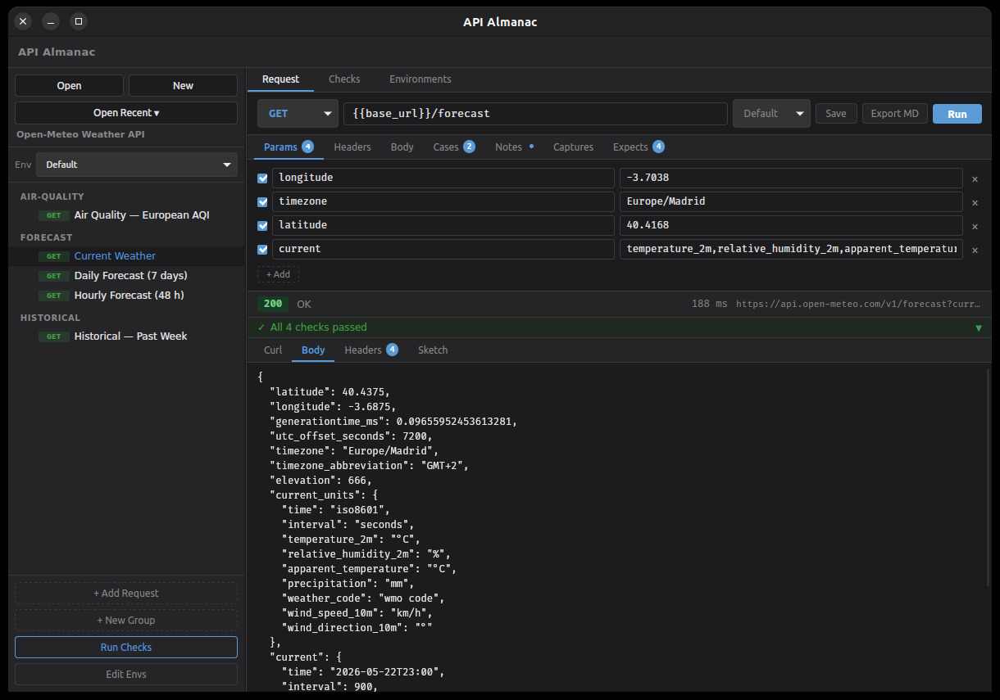

## The problem

You are integrating with a third-party API. Over an afternoon you work out
which headers it really needs, which query parameters matter, what the
response looks like and which call has to come first to get a token. Then
you move on, and three months later you need all of it again.

By then the knowledge is scattered: a few cURL commands in your shell
history, a half-finished collection in a hosted API client, some notes in
another app. None of it says what the response *looked like*, and none of
it is in the repository next to the code that depends on it.

<div class="compare">
  <div>
    <h3>The usual way</h3>
    <p>Throwaway cURL commands, or a collection locked inside a hosted
    client with an account and a sync service, and your notes kept
    somewhere else.</p>
  </div>
  <div class="good">
    <h3>With API Almanac</h3>
    <p>A project folder of readable YAML: the requests, their environments,
    what you expect back and why. Open it, pick a request, press Run.</p>
  </div>
</div>

API Almanac is deliberately not an enterprise API platform. Its README
calls it a developer's field notebook for APIs, with executable requests
and response archaeology: it remembers the last response of every request,
sketches its shape, and lets you write down what you learned right next to
the call.

## How it works

A project is an ordinary folder with an `almanac.yaml` at its root, one
file per environment and one file per request. Templates such as
`{{base_url}}` are filled in from the selected environment when you run a
request, and secrets are referenced as `{{secret.API_TOKEN}}`, which reads
an OS environment variable at run time, so the value never lands on disk.

<ol class="steps">
  <li><strong>Open</strong><span>Open a project folder, or start a new one. Requests appear in a sidebar, grouped by folder.</span></li>
  <li><strong>Explore</strong><span>Edit the method, URL, params, headers and body, choose an environment, and run it.</span></li>
  <li><strong>Keep</strong><span>Save it with notes, expectations and captures. The YAML is what you commit.</span></li>
</ol>

<figure class="shot">
  
  <figcaption>The bundled Open-Meteo demo project: a request, its
  parameters, and a response that passed all four checks.</figcaption>
</figure>

## Made to be revisited

<div class="features">
  <div>
    <h3>Your project is just files</h3>
    <p>Plain YAML in folders you choose. Each request keeps a stable ID, so
    renames and reordering stay readable in a Git diff.</p>
  </div>
  <div>
    <h3>Know when an API changes</h3>
    <p>Expectations on status, response time, headers and JSON or XML
    fields run with every request and show pass or fail, with the expected
    and the actual value.</p>
  </div>
  <div>
    <h3>Chain calls without copy and paste</h3>
    <p>Captures pull values such as a token or a new ID out of a response
    into session variables for the next request. Cases switch between named
    sets of variables.</p>
  </div>
  <div>
    <h3>See the shape, not just the data</h3>
    <p>TypeSketch infers a short YAML summary of a response's structure.
    The last response of every request is saved and shown again when you
    reopen it.</p>
  </div>
  <div>
    <h3>Check everything in one go</h3>
    <p>The spot-check runner runs every request in order, carries captured
    values forward and exports a Markdown report. A dry run shows the
    resolved cURL command without sending anything.</p>
  </div>
  <div>
    <h3>Docs and tools from the same source</h3>
    <p>Export any request as a Markdown notebook, use the
    <code>almanac</code> CLI in scripts, or plug in your own analyzer
    written in any language that reads stdin.</p>
  </div>
</div>

## What it supports today

API Almanac is early-stage software at version 0.0.1. It has no packaged
releases yet, so you build it from source. It is a Tauri 2 desktop app
with a Rust backend and a React front end, plus a separate command-line
tool.

- Request bodies as JSON, XML, form data or plain text, with an editable
  tree view for JSON and XML
- Environments that inherit from a parent environment, and secrets read
  from OS environment variables
- Expectations, captures, cases and per-request notes, all editable in the
  app and stored in the request's YAML
- Folder groups with drag-and-drop ordering, duplicate requests and recent
  projects
- Analyzer plugins: any external program that receives the request and
  response as JSON and returns HTML, YAML or Markdown

Some things are on the roadmap rather than in the app: only the latest
response of each request is kept (no history or response diff yet), and
there are no multi-request flows beyond the spot check, no keyring or
`.env` secret backend, and no OpenAPI import. The project format is
documented precisely enough for an AI agent to generate a whole project
from an API's docs; the bundled demo was made that way.

## Get started

### 1. Build and run the app

You need Rust (stable), Node.js 18 or later, and the
[Tauri prerequisites](https://v2.tauri.app/start/prerequisites/) for your
platform (webkit2gtk on Linux, WebView2 on Windows).

```bash
git clone https://github.com/arturormk/api-almanac-rust.git
cd api-almanac-rust
npm install
npm run tauri dev
```

The app window opens on its own. To build an installer instead, run
`npm run tauri build`; the result goes to
`src-tauri/target/release/bundle/`.

### 2. Open the demo project

Choose **Open** and pick the `demos/open-meteo/` folder in the clone. It
covers the free [Open-Meteo](https://open-meteo.com) weather API, which
needs no key or account. Pick **Current Weather**, press **Run**, and look
at the response, its checks and the **Sketch** tab.

### 3. Try the CLI

The `almanac` binary works on the same project files. It looks for
`almanac.yaml` in the current folder and its parents:

```bash
cargo build -p api-almanac-cli
cd demos/open-meteo
alias almanac=../../target/debug/almanac

# List the requests in the project
almanac list

# Run one request by its ID
almanac run forecast.current-weather --env default

# Run every request in order, with checks
almanac spot-check --env default

# Write a Markdown notebook for a request to docs/
almanac export-md forecast.current-weather
```

### 4. Start your own project

A project needs only an `almanac.yaml` with an `id` and a `name`, an
environment file and a request file. Click **New** in the app, or copy the
demo and adapt it. To have an AI agent draft one from your API's docs,
adapt the demo's
[generation prompt](https://github.com/arturormk/api-almanac-rust/blob/main/demos/open-meteo/PROMPT.md).

## Learn more

- **[README](https://github.com/arturormk/api-almanac-rust/blob/main/README.md)**:
  every feature, the file format with examples, expectation rules and the
  plugin interface.
- **[Project format reference](https://github.com/arturormk/api-almanac-rust/blob/main/API-ALMANAC.md)**:
  the complete YAML specification, written so that an AI agent can generate
  a valid project.
- **[Design blueprint](https://github.com/arturormk/api-almanac-rust/blob/main/docs/BLUEPRINT.md)**:
  the product vision and milestone plan.
- **[Sample plugin](https://github.com/arturormk/api-almanac-rust/tree/main/examples/tools)**:
  a small Python analyzer to start your own from.
- **[Issues](https://github.com/arturormk/api-almanac-rust/issues)**: bug
  reports and feature requests.

API Almanac is dual-licensed under MIT or Apache-2.0, at your option.
