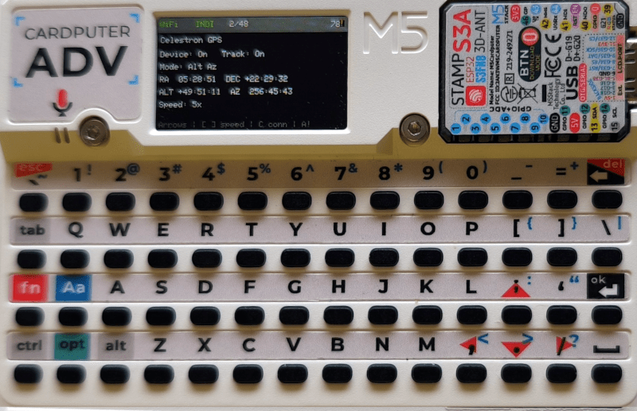

## Why

Your telescope is run by a small Linux computer, often a Raspberry Pi,
with `indiserver` exposing the mount and the camera on the network. That
works well for planning and imaging from a laptop. But out at the
telescope you mostly want small things: centre a star with a gentle
nudge, stop the mount *now*, take one test exposure, check that tracking
is on.

Unlocking a phone or carrying a laptop out for that is clumsy in the
dark and the cold. This firmware gives you a dedicated device with real
keys instead, one that does those few jobs well.

<div class="compare">
  <div>
    <h3>A laptop or phone at the telescope</h3>
    <p>A bright screen, a full desktop client and a touchscreen to tap
    with cold fingers, just to move the mount a little.</p>
  </div>
  <div class="good">
    <h3>A Cardputer in your pocket</h3>
    <p>Hold an arrow key to nudge, press <code>A</code> to stop all
    motion, press Space to expose. It talks to the same INDI server
    directly.</p>
  </div>
</div>

<figure class="shot">
  
  <figcaption>The mount screen, connected to a Celestron mount through
  the <code>indi_celestron_gps</code> driver.</figcaption>
</figure>

## How it works

The Cardputer connects to your INDI server over Wi-Fi and speaks the
INDI protocol itself, with no proxy in between. It discovers the devices
the server offers and recognises mounts and cameras by the standard
properties they expose, not by brand or model. Anything else is still
there to look at in a read-only property inspector.

<ol class="steps">
  <li><strong>Serve</strong><span>Run <code>indiserver</code> with your mount and camera drivers on a computer at the telescope.</span></li>
  <li><strong>Connect</strong><span>On the Cardputer, pick a Wi-Fi network and enter the server's address. It is tested, then saved.</span></li>
  <li><strong>Control</strong><span>Choose a device from the list and use its screen: nudge and abort for mounts, expose for cameras.</span></li>
</ol>

## Made for the field

<div class="features">
  <div>
    <h3>Motion you can trust</h3>
    <p>The mount moves only while you hold an arrow key and stops when you
    let go. <code>A</code> aborts all motion, even from other screens while
    the mount is selected.</p>
  </div>
  <div>
    <h3>Location and time from GPS</h3>
    <p>With the Cap LoRa868 GNSS module fitted, compare the mount's
    location and clock with live GPS data and send the fix with one key.</p>
  </div>
  <div>
    <h3>Not tied to one brand</h3>
    <p>Controls appear when the driver offers the standard properties for
    them, such as <code>TELESCOPE_MOTION_NS</code> or
    <code>CCD_EXPOSURE</code>.</p>
  </div>
  <div>
    <h3>Set up on the device</h3>
    <p>Wi-Fi and server settings are entered on the Cardputer and kept
    across restarts, but only after the connection test succeeds.</p>
  </div>
  <div>
    <h3>Recovers on its own</h3>
    <p>Lost Wi-Fi or a restarted INDI server? It reconnects by itself, so
    you can get back to observing.</p>
  </div>
  <div>
    <h3>Small by design</h3>
    <p>A streaming XML parser and a bounded property cache fit the
    ESP32-S3's memory. Image downloads are switched off.</p>
  </div>
</div>

## What it supports today

Version 1.0 is a stable release, and the firmware has been under active
development since then. It runs on one device: the **M5Stack Cardputer
ADV**.

- **Mounts**: connection and tracking state, tracking mode and slew
  speed, RA/Dec and Alt/Az when the driver reports them, hold-to-nudge
  in four directions, slew rates chosen with `[` and `]` or the number
  keys, and an emergency abort.
- **Mount sync from GNSS**: latitude, longitude, UTC and, with a 3D fix,
  elevation, sent to mounts with writable `GEOGRAPHIC_COORD` and
  `TIME_UTC`. If anything required is missing, nothing is sent.
- **Cameras**: choose an exposure time and start it through
  `CCD_EXPOSURE`, and choose ISO when the driver offers a writable ISO
  switch.
- **Everything else**: a read-only inspector for every device, property
  and value.

Vendor-specific DSLR actions, image previews and image downloads are not
supported. A driver advertising a property doesn't guarantee the
hardware honours it. The firmware keeps a limited number of devices and
properties in memory; when a server sends more, a yellow `!` warns that
some were left out.

Park and unpark, tracking control, a red night mode, focusers, filter
wheels and camera gain are planned in the
[roadmap](https://github.com/arturormk/cardputer-adv-indi-controller/blob/main/docs/ROADMAP.md),
with no promised dates.

## Get started

You need a Cardputer ADV, a computer with [PlatformIO](https://platformio.org/)
to flash it, and an INDI server on the same network. The README shows a
complete server setup for a Celestron NexStar mount on a Raspberry Pi.

### 1. Flash the firmware

Connect the Cardputer over USB and, from a clone of the repository:

```bash
git clone https://github.com/arturormk/cardputer-adv-indi-controller.git
cd cardputer-adv-indi-controller
# build and upload the cardputer-adv environment
./flash
```

Each tagged [release](https://github.com/arturormk/cardputer-adv-indi-controller/releases)
also carries a complete flashable image, `indi-controller-<tag>.bin`.

### 2. Start an INDI server

On the computer at the telescope, start `indiserver` with your drivers.
For a Celestron NexStar-compatible mount:

```bash
indiserver -v -p 7624 indi_celestron_gps
```

Choose the mount's serial port (for example `/dev/ttyUSB0`) once from an
INDI client such as KStars/Ekos; the driver remembers it. Make sure TCP
port 7624 is not blocked by a firewall.

### 3. Configure and connect

On the Cardputer, press `S` in the device list. Pick your Wi-Fi network,
type its password, enter the server's address and port `7624`, then
select **Test & save**.

The device list fills in once it connects. The punctuation keys with
printed arrows (`;` `.` `,` `/`) move around; Enter opens a device and
Backspace goes back. On the mount screen, hold an arrow to nudge, use
`[` and `]` to change the slew rate, and press `A` to stop everything.

## Learn more

- **[README](https://github.com/arturormk/cardputer-adv-indi-controller/blob/main/README.md)**:
  every key on every screen, the GNSS details, the NexStar server setup
  and the build and versioning scheme.
- **[Changelog](https://github.com/arturormk/cardputer-adv-indi-controller/blob/main/CHANGELOG.md)**:
  what changed since v1.0.
- **[Roadmap](https://github.com/arturormk/cardputer-adv-indi-controller/blob/main/docs/ROADMAP.md)**
  and **[design blueprint](https://github.com/arturormk/cardputer-adv-indi-controller/blob/main/docs/BLUEPRINT.md)**:
  where it is heading and why it is built the way it is.
- **[Issues](https://github.com/arturormk/cardputer-adv-indi-controller/issues)**:
  bug reports and drivers that don't behave as expected.

Cardputer INDI Controller is MIT licensed.
