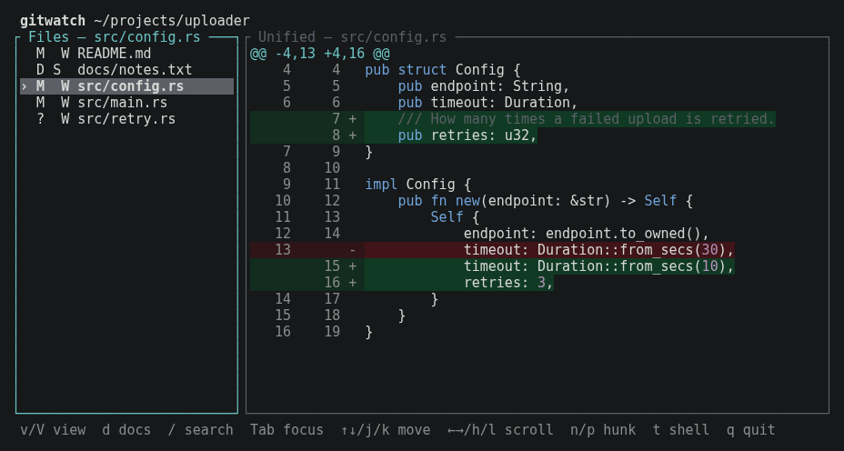
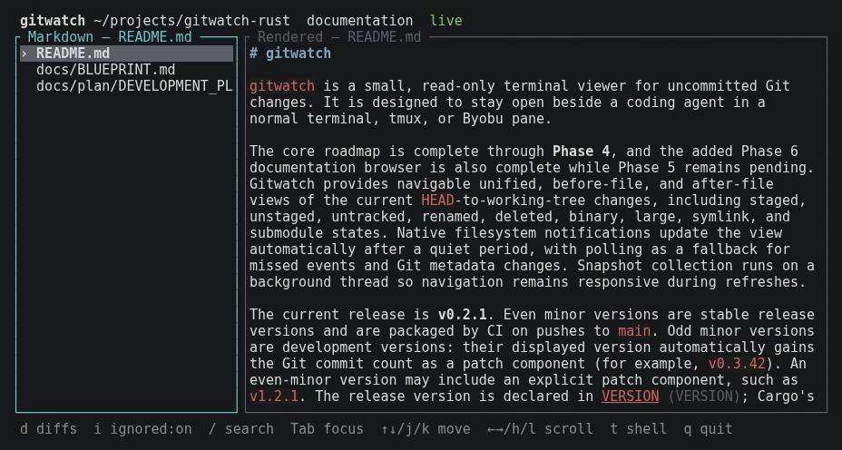

## The problem

You ask a coding agent such as Claude Code or Codex to make a change, and it
starts editing files. You want to follow along: which files it touched, what
it removed, whether that refactor went where you expected. You don't want
to go back to a GUI editor to do it.

The terminal options aren't quite right. Running `git diff` over and over
misses untracked files and shows staged and unstaged changes separately.
`watch git diff` redraws from the top every time and loses your place. A
full Git client is built for staging and committing, which is exactly what
you don't want to do by accident while someone else is driving.

<div class="compare">
  <div>
    <h3>The usual way</h3>
    <p>Re-run <code>git status</code> and <code>git diff</code> by hand,
    scroll back to where you were, and remember to check the new files
    separately.</p>
  </div>
  <div class="good">
    <h3>With gitwatch</h3>
    <p>One pane that lists every changed file and shows its diff, refreshes
    a couple of seconds after the agent stops typing, and keeps your place
    while it does.</p>
  </div>
</div>

## How it works

gitwatch compares the current `HEAD` with your working tree, so staged,
unstaged and untracked changes all appear together, once per file. It
watches the files for changes and refreshes after a short quiet period, with
a periodic Git check as a fallback for anything the notifications miss. When
the agent commits, those changes simply disappear from the list, and the
next edits start a clean slate.

<ol class="steps">
  <li><strong>Open it</strong><span>Run <code>gitwatch</code> in your repository, in a pane beside the agent.</span></li>
  <li><strong>Let the agent work</strong><span>Changed files appear on the left and their diffs on the right, updated automatically.</span></li>
  <li><strong>Read and decide</strong><span>Move between files and hunks, switch to the full before or after file, then tell the agent what's next.</span></li>
</ol>

<figure class="shot">
  
  <figcaption>Changed files on the left (modified, deleted, untracked), and
  the selected file's diff on the right.</figcaption>
</figure>

## Made to sit beside an agent

<div class="features">
  <div>
    <h3>Nothing to press</h3>
    <p>Refreshes wait for a 2-second pause in file activity, but never more
    than 10 seconds while changes keep coming. <code>r</code> refreshes
    straight away if you want it.</p>
  </div>
  <div>
    <h3>Keeps your place</h3>
    <p>Your selected file, view and scroll position survive refreshes. Git
    runs on a background thread, so the interface stays responsive while it
    does.</p>
  </div>
  <div>
    <h3>Three ways to read a change</h3>
    <p>Press <code>v</code> to switch between the unified diff and the
    complete before and after files, with changed lines still highlighted
    and your position kept.</p>
  </div>
  <div>
    <h3>Can't change your repository</h3>
    <p>It never stages, commits, resets, checks out or edits anything. Git
    runs only from a short list of query commands, without prompts, pagers,
    external diff tools or optional index locks.</p>
  </div>
  <div>
    <h3>The docs, too</h3>
    <p>Press <code>d</code> to browse every Markdown file in the repository,
    rendered in the terminal and reloaded when the agent edits it. Press
    <code>d</code> again to return to the diffs.</p>
  </div>
  <div>
    <h3>Stays in the terminal</h3>
    <p>Vim-style keys and search, mouse clicks and scrolling, and
    <code>t</code> for a quick shell at the repository root. No
    configuration needed.</p>
  </div>
</div>

<figure class="shot">
  
  <figcaption>Documentation mode: the repository's Markdown files, rendered
  in the terminal.</figcaption>
</figure>

## What it supports today

gitwatch is at version 0.2.1, a stable pre-1.0 release. The core viewer and
the documentation browser are complete; the hardening and acceptance work
planned before 1.0 (wider testing of worktrees, concurrent writes, profiling
and manual smoke tests) hasn't started yet. It is built for Linux
terminals, including tmux and Byobu panes, and it uses the `git` command
already on your system.

- Modified, added, deleted, renamed and untracked files, including files
  with both staged and unstaged changes
- Binary files, files over 4 MiB, symlinks and submodules, each shown with
  a short explanation instead of unreadable content
- Repositories without a first commit, and running from a subdirectory
- Basic syntax colouring for Rust, C-family languages and languages with
  `#` comments

It is deliberately *only* a viewer. There is no staging, committing,
history browsing, commit review or branch management, and it is not meant to
compete with Lazygit or GitUI. Changed files are shown as a flat list of
paths rather than a collapsible tree, and there are no theme or
configuration files. There are no published binaries yet: you build it from
source, optionally as a `.deb` or `.rpm` package.

## Get started

### 1. Build it

You need Git and a stable Rust toolchain (1.88 or newer):

```bash
git clone https://github.com/arturormk/gitwatch-rust.git
cd gitwatch-rust
# Build the release executable
./quickstart.sh exe
sudo cp target/release/gitwatch /usr/local/bin/
```

Or build a package instead. `./quickstart.sh deb` needs `dpkg-deb`, and
`./quickstart.sh rpm` needs `rpmbuild`; both write to `target/packages/`:

```bash
./quickstart.sh deb
sudo apt install ./target/packages/gitwatch_*.deb
```

### 2. Run it beside your agent

Open a second terminal or tmux pane and start gitwatch inside your
project, or point it at one:

```bash
cd ~/projects/uploader
gitwatch

# Or from anywhere
gitwatch ~/projects/uploader
```

### 3. Find your way around

- `j` / `k` or the arrow keys move, and `Tab` switches between the file
  list and the diff.
- `n` / `p` jump to the next or previous hunk.
- `v` / `V` cycle through the unified, before and after views.
- `/` searches the right pane; `n` / `N` step through matches.
- `d` toggles the documentation browser, and `t` opens a shell
  (type `exit` to come back).
- `q` quits.

If the default timings don't suit you, change them at startup:

```bash
gitwatch --quiet-ms 1000 --max-delay-ms 5000
```

## Learn more

- **[README](https://github.com/arturormk/gitwatch-rust/blob/main/README.md)**:
  every key, the refresh timings, packaging and the versioning scheme.
- **[Blueprint](https://github.com/arturormk/gitwatch-rust/blob/main/docs/BLUEPRINT.md)**:
  the product definition, including the read-only guarantee and explicit
  non-goals.
- **[Development plan](https://github.com/arturormk/gitwatch-rust/blob/main/docs/plan/DEVELOPMENT_PLAN.md)**:
  the architecture, the phases and their status, and what is deferred.
- **[Issues](https://github.com/arturormk/gitwatch-rust/issues)**: bug
  reports and feature requests.

gitwatch is MIT licensed. It runs your system's Git as a separate program
under its own licence.
