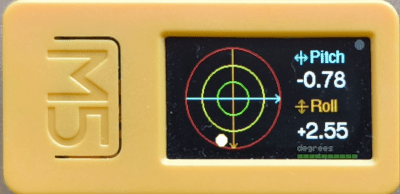
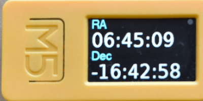

## Why

An Alt/Az GoTo mount such as a NexStar aligns best when its base is
level, so you start every session by levelling the tripod. Then a small
computer, often a Raspberry Pi, drives the mount, and its idea of where
the telescope is pointing lives on a laptop or phone screen.

At the telescope you want both in front of you: how level the mount is,
and what the computer is doing. And a script on the Pi would like to know
the tilt too, which a spirit level can't tell it.

<div class="compare">
  <div>
    <h3>A spirit level on the tripod</h3>
    <p>A bubble you read by eye, by torchlight. Nothing for the computer
    to check, and the time and coordinates are on another screen.</p>
  </div>
  <div class="good">
    <h3>The clinometer on the mount</h3>
    <p>Pitch and roll in degrees, the time and the mount's coordinates
    on one small screen, all reachable over Bluetooth from the Pi.</p>
  </div>
</div>

<figure class="shot">
  
  <figcaption>The clinometer screen on an M5StickC Plus 2: a bubble with
  1°, 2° and 3° rings, and pitch and roll in degrees.</figcaption>
</figure>

## How it works

The firmware reads the device's built-in accelerometer about 15 times a
second and draws a bubble level. The front button cycles through the
other screens: the time, the mount's RA/Dec and Alt/Az, and the battery.

The device also runs a Bluetooth LE service with a plain-text protocol:
one short ASCII command in, one reply out. A computer nearby can ask for
the tilt, push new coordinates to the screen or show a message, whatever
screen is active. The repository includes `m5ctl`, a Python
command-line client that speaks this protocol for you.

<ol class="steps">
  <li><strong>Flash</strong><span>Put the firmware on an M5StickC Plus 2, or build it for another supported M5Stack board.</span></li>
  <li><strong>Connect</strong><span>Find the device with <code>m5ctl scan</code> and save its address once.</span></li>
  <li><strong>Use</strong><span>Level the mount on the clinometer screen, then let your scripts set the clock, coordinates and messages.</span></li>
</ol>

<figure class="shot">
  
  <figcaption>The RA/Dec screen, showing coordinates sent over
  Bluetooth.</figcaption>
</figure>

## Made for the telescope

<div class="features">
  <div>
    <h3>Level that knows your mounting</h3>
    <p>Set the zero from any orientation with <code>calibrate</code>, and
    choose which screen axis is pitch and which is roll, so the readings
    make sense however the device is fixed to the mount.</p>
  </div>
  <div>
    <h3>Scriptable from the Pi</h3>
    <p>Ask for the tilt, or stream it, and update the RA/Dec and Alt/Az
    screens as the mount moves. Messages can wait for a button press and
    report it back.</p>
  </div>
  <div>
    <h3>Clock for the observer</h3>
    <p>Local time with any UTC offset and label, or local and Greenwich
    sidereal time computed from UTC and your longitude.</p>
  </div>
  <div>
    <h3>Easy on dark-adapted eyes</h3>
    <p>Night mode turns every colour red. The backlight dims itself when
    nothing is happening, and a long press of the front button steps
    through brightness levels.</p>
  </div>
  <div>
    <h3>Remembers your setup</h3>
    <p>UTC is kept in the hardware clock. The time zone, longitude,
    calibration and axis choice are saved only when you send
    <code>persist</code>, and come back on every boot.</p>
  </div>
  <div>
    <h3>Batch and timed scripts</h3>
    <p><code>m5ctl</code> runs whole setup files over one connection, and
    timed scripts that wait, loop, check replies or wait for a tilt.</p>
  </div>
</div>

## What it supports today

The latest release is v1.4.0. The reference device is the **M5StickC
Plus 2**, and each release carries a ready-to-flash firmware image for
it. The same firmware builds from source for the **M5StickS3**, **M5Stack
Core2**, **CoreS3** and **Grey**; the screen layout adapts to their
larger displays.

- **Screens**: clinometer, time, RA/Dec, Alt/Az, battery (with an
  optional charge-history graph) and four system-information pages, plus
  a full-screen message overlay with Unicode fonts.
- **Bluetooth**: a single GATT service with a text protocol. The README
  documents every command, reply and error.
- **Tools**: `m5ctl` for the command line, an interactive terminal and
  scripts; a live 3D orientation viewer; and `batplot`, a chart viewer
  for the optional battery log.

The device shows the coordinates it is sent; it doesn't talk to the mount
itself. Boards without a hardware clock, such as the Grey, forget the
time when powered off, so it has to be set again after each boot. On the
M5StickC Plus 2, an ENV III unit on the Grove port makes the battery
voltage read wrong because of an upstream library bug; the firmware shows
`-- V` instead. Wi-Fi is out of scope for now: everything goes
over Bluetooth LE.

## Get started

You need an M5StickC Plus 2 and a USB cable, and a computer with
Bluetooth for `m5ctl`. To build for other boards, use
[PlatformIO](https://platformio.org/) and the repository's `./flash`
script instead of step 1.

### 1. Flash the firmware

Download `firmware-v1.4.0-m5stickc-plus2.bin` from the
[latest release](https://github.com/arturormk/m5stickc-ble-clinometer/releases/latest).
The simplest way to flash it is the
[ESP Web Flasher](https://espressif.github.io/esptool-js/) in Chrome or
Edge, at address `0x0000`. From a terminal, `esptool` does the same:

```bash
pip install esptool
python -m esptool --chip esp32 --port /dev/ttyUSB0 \
    --baud 921600 write_flash 0x0000 \
    firmware-v1.4.0-m5stickc-plus2.bin
```

Reset the device and the clinometer screen appears.

### 2. Find the device

`m5ctl` uses [uv](https://docs.astral.sh/uv/) for its dependencies. From
a clone of the repository:

```bash
git clone https://github.com/arturormk/m5stickc-ble-clinometer.git
cd m5stickc-ble-clinometer
uv sync
# look for M5-NexStar-Level and note its address
uv run tools/m5ctl scan
```

Save that address in `.m5ctl.conf` at the project root, and every
`m5ctl` command uses it from then on:

```ini
device.main = AA:BB:CC:DD:EE:FF
```

### 3. Level, set up and save

```bash
# Current pitch and roll in degrees
uv run tools/m5ctl tilt

# Set the clock and show local time with its zone label
uv run tools/m5ctl set-time-now

# Your longitude, for local sidereal time
uv run tools/m5ctl set-longitude -3.7

# Send coordinates to the RA/Dec screen
uv run tools/m5ctl set-radec 06:45:09 -16:42:58

# Keep zone, longitude and calibration across reboots
uv run tools/m5ctl persist
```

When you're ready to explore, `uv run tools/m5ctl terminal`
opens an interactive session, and `uv run tools/m5ctl run tools/demo.m5s`
takes the device through all of its features.

## Learn more

- **[README](https://github.com/arturormk/m5stickc-ble-clinometer/blob/main/README.md)**:
  every screen, button and BLE command, the `m5ctl` reference, other
  ways to flash and the test suite.
- **[Changelog](https://github.com/arturormk/m5stickc-ble-clinometer/blob/main/CHANGELOG.md)**:
  what changed in each release.
- **[Know-how](https://github.com/arturormk/m5stickc-ble-clinometer/blob/main/docs/KNOW-HOW.md)**
  and the **[angle convention](https://github.com/arturormk/m5stickc-ble-clinometer/blob/main/docs/adr/0002-angle-convention.md)**:
  lessons learned building it, and exactly how pitch and roll are
  defined on each board.
- **[Issues](https://github.com/arturormk/m5stickc-ble-clinometer/issues)**:
  bug reports and ideas.

M5 Bluetooth Clinometer is MIT licensed.
