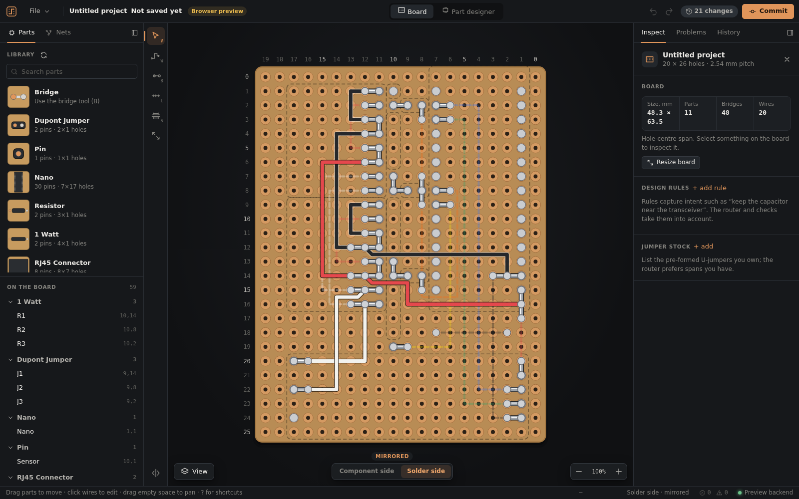
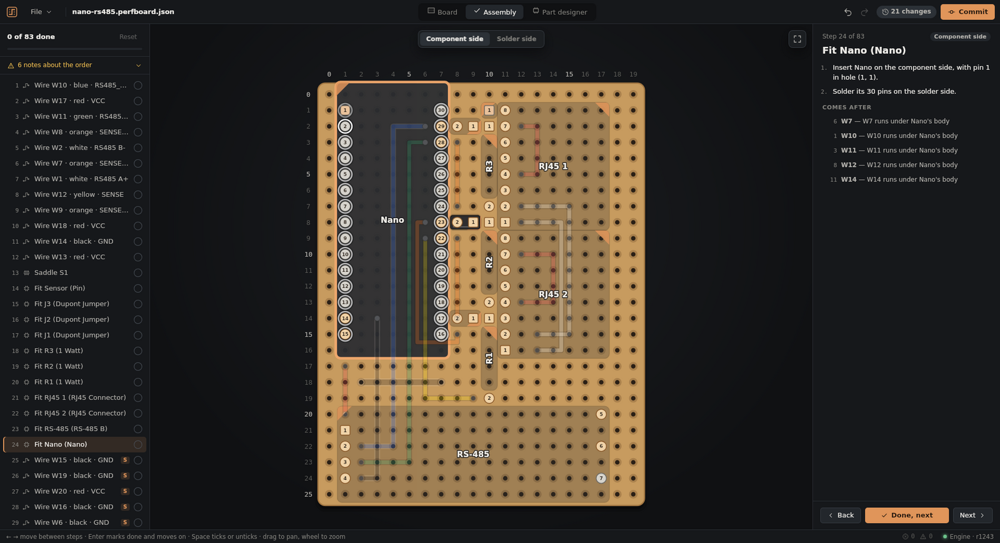
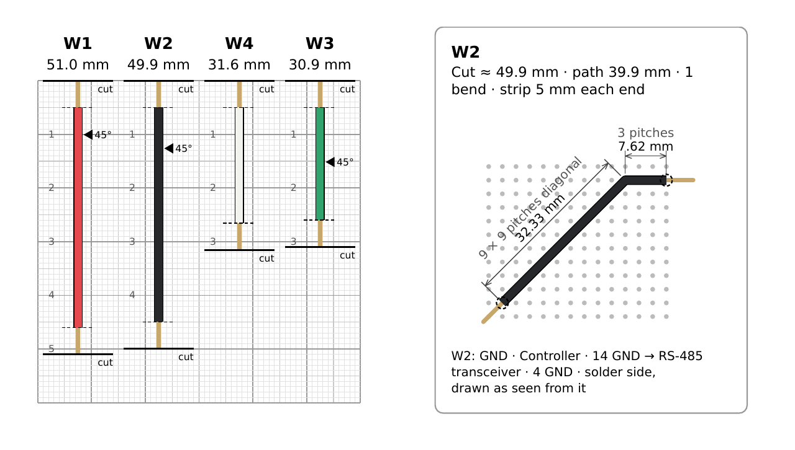

## The problem

Perfboard is the quickest way to turn a breadboard prototype into
something that lasts: an Arduino Nano, a couple of breakout modules, a
few resistors and connectors. The hard part is the layout. Every wire
has to fit between the holes, it can't cross a pin you have already
soldered, and the order you solder things in suddenly matters.

Most people plan it on squared paper or in a spreadsheet. PCB tools can
do it, but they were made for something else and don't understand a
board where you solder every wire and bridge by hand.

<div class="compare">
  <div>
    <h3>The usual way</h3>
    <p>Sketch the layout on paper, count holes, rub out and redraw, and
    hope you didn't miss a connection before you pick up the soldering
    iron.</p>
  </div>
  <div class="good">
    <h3>With Perfboard Designer</h3>
    <p>Place parts on a hole-accurate board, let the router suggest wire
    runs, and ask your coding agent to finish, check and tidy up the
    layout while you watch.</p>
  </div>
</div>

## Built to be shared with an agent

The core idea is that **a human and an AI agent are equal participants
in the same design**. Both go through the same Rust engine, the same
validation and the same history, so there is one source of truth and
nothing to import or export.

<ol class="steps">
  <li><strong>Open</strong><span>Start the desktop app and open your design. It announces itself to local MCP clients and to nothing else.</span></li>
  <li><strong>Ask</strong><span>In Claude Code or Codex, describe what you want: "connect the RS-485 module to the Nano's serial pins and route the RJ45 jacks".</span></li>
  <li><strong>Review</strong><span>Agent edits appear on the board as they happen, marked in the history with the agent's reasons. You accept, undo or commit.</span></li>
</ol>

<figure class="shot">
  
  <figcaption>The solder side of an Arduino Nano RS-485 node with two RJ45
  jacks, mirrored as you see it when you flip the board: the parts library
  on the left, the bridges and wires in the middle, and the inspector with
  Problems and History on the right.</figcaption>
</figure>

The MCP server gives the agent the same tools you have, and no more:

<div class="features">
  <div>
    <h3>Read the design</h3>
    <p>The full project, the board, the parts library with each part's
    documentation, the validation report, the assembly plan and a
    rendered picture of either side of the board.</p>
  </div>
  <div>
    <h3>Edit it</h3>
    <p>Place, move and rotate parts, create, rename and merge nets, draw
    wires, bridges, rails and saddles, all as grouped operations that land
    as one step in the history.</p>
  </div>
  <div>
    <h3>Route with the engine</h3>
    <p>Ask the deterministic router for suggested wire runs, with
    alternatives to choose from, or have it evaluate a route the agent
    drew itself before committing to it.</p>
  </div>
  <div>
    <h3>Keep a history</h3>
    <p>Commit named checkpoints with a description, compare any two
    revisions and restore an earlier one, just like the History tab.</p>
  </div>
</div>

### You stay in charge

An agent is good at electronic common sense and tedious routing. It is
not the one holding the soldering iron. So:

- **Electrical changes need your approval.** Connections an agent
  proposes show up under *Needs your approval* in the Nets panel and stay
  inactive until you accept them. Routing nets you have already approved
  is just layout and doesn't ask again.
- **No lost edits.** Every write must quote the revision it was based on.
  If you changed the board in the meantime, the agent's write is refused
  and it has to look again, so neither side overwrites the other.
- **Agent steps are visible.** They are marked in violet in the History
  tab, with the rationale the agent gave, and undo like any other step.
- **A narrow door.** The bridge listens only on the local loopback
  interface and authenticates every request with a token created for that
  launch. It offers no file or shell access.
- **Received projects stay in their folder.** A project someone sends you
  reads parts only from its own folder and the standard library, never
  from elsewhere on your computer, until you grant it access. Agents can
  read the parts but can't change where they come from.

### House rules in plain English

Because the agent reads your instructions as well as the board, you can
hand it the conventions you build by. These are the rules used for the
Nano RS-485 example:

> 1. Run every wire from an empty perfboard hole to an empty perfboard hole.
> 2. To connect a wire to a component pin, end the wire in a neighbouring
>    empty hole and bridge the gap after the other soldering is complete.
> 3. Route wires only horizontally or vertically, with 90-degree bends.
> 4. Don't route a wire across a soldered component pin.

The engine checks the geometry; the agent applies the judgment.

## Also a good editor on its own

Perfboard Designer is fully usable without an agent.

<div class="features">
  <div>
    <h3>Hole-accurate board</h3>
    <p>Parts snap to the 2.54 mm grid. Switch between the component side
    and a mirrored solder side, exactly as the board looks when you flip
    it over.</p>
  </div>
  <div>
    <h3>Wires, bridges and rails</h3>
    <p>Draw wires pin to pin with bends where you click. Unrouted
    connections show as dashed lines; click one for a suggested route,
    then flip through alternatives with the number keys: a different
    path, fewest bends, shortest, or the other side of the board.
    Rails take their own colour and connection nodes, and saddles tie
    wire bundles down to the board.</p>
  </div>
  <div>
    <h3>Nets that stay tidy</h3>
    <p>Rename nets, remove unused ones, or merge two into one. A jumper
    can be left open or shunted, and a shunt can join two nets, as a
    selector jumper does. Placed parts get reference designators: R1,
    C2, U1.</p>
  </div>
  <div>
    <h3>Problems with advice</h3>
    <p>Overlaps, out-of-bounds parts and unrouted nets are listed with
    advice, and clicking a problem frames it on the board.</p>
  </div>
  <div>
    <h3>Your own parts</h3>
    <p>Keep parts in a folder that travels with the project, or in a
    library of your own shared by several projects. The Part designer
    edits body outlines, pins, keepouts and documentation, and copies a
    standard part when you want to change it. Parts are plain TOML and
    Markdown files you can keep in Git.</p>
  </div>
  <div>
    <h3>Ready for the bench</h3>
    <p>Step through the build in Assembly mode, print a build drawing
    with the wire list and a build-order checklist, and export true-scale
    wire guides (see below).</p>
  </div>
  <div>
    <h3>Local files</h3>
    <p>A design is a single human-readable JSON file. No account, no
    cloud.</p>
  </div>
</div>

## From screen to solder

A layout is only useful once it is on the board, and on perfboard the
order you build in matters: a wire that runs under a part has to go in
first, a bridge can only be made once everything that ends in its holes
is soldered, a rail before the wires soldered to it. Perfboard
Designer works that order out for you.

### A build plan, step by step

The app derives an assembly plan from the design: one step per part,
wire, rail, bridge and saddle, followed by checks. Physical
dependencies come first, each with the reason it was added. Within
them, it follows the usual bench habits: flat wires and rails on the
component side, then small parts, smallest first, then larger ones,
then the solder side, bridges last. The same design always gives the
same plan, and it updates as soon as you, or an agent, change the board.

<div class="features">
  <div>
    <h3>Assembly mode</h3>
    <p>A third workspace next to the editor. The board shows only what
    is installed up to the current step, with the holes for this step
    ringed, and flips to the face you are working on. Press Enter to
    tick a step and move to the next one.</p>
  </div>
  <div>
    <h3>Everything for the step</h3>
    <p>Instructions, notes, the steps it comes after, and for wires and
    rails the colour, net, approximate cut length, bends and endpoints,
    plus a fitting jumper from your inventory when there is one.</p>
  </div>
  <div>
    <h3>Checks before power</h3>
    <p>The last steps ask for a look at the solder side, a continuity
    test per net and a short test between supply and ground. Pick a
    measurement and the board lights up its net and rings the pins to
    probe.</p>
  </div>
  <div>
    <h3>Progress that keeps up</h3>
    <p>Checkmarks are kept per project, outside the design file. If you
    change a step you already ticked, it is flagged, and a banner says
    what the edit added, changed or removed in the plan.</p>
  </div>
</div>

<figure class="shot">
  
  <figcaption>Assembly mode on the Nano RS-485 example, at step 24 of 83.
  The five wires that run under the Nano went in first, and the panel on
  the right lists them under <em>Comes after</em>, each with the reason.
  The solder-side wires (marked S) and the bridges come next.</figcaption>
</figure>

Agents can read the same plan through MCP, so you can ask yours to
explain the order or to suggest a layout change that makes the board
easier to build. They read it; they don't reorder it behind your back.

### On paper

**File → Print build drawing** puts the plan on paper for the bench, or
for handing the build to someone else: both faces of the board, the
wire list in the order the wires go in, with estimated cut lengths and
a tick box for each, and a build-order checklist with every step and a
box for each continuity measurement. Steps you have already ticked in
the app print as done.

### Wires cut and bent to size

**File → Export wire templates…** turns every wire and rail in the
design into a PDF you print and build from, at exactly 1:1:

<div class="features">
  <div>
    <h3>Cut guide</h3>
    <p>Every wire laid out straight in its own column on a millimetre
    grid, in its insulation colour, with both cut lines, the strip marks
    and a triangle with the angle at each bend. Hold the wire against it
    as it comes off the spool, mark it, and cut. Rails also show where to
    strip the insulation for each connection point.</p>
  </div>
  <div>
    <h3>Bending templates</h3>
    <p>Each wire shape drawn full size over the board's hole grid, every
    run dimensioned in millimetres and in hole pitches. Lay the cut wire
    on its template and bend it to match. Wires with the same shape share
    one template.</p>
  </div>
</div>

<figure class="shot">
  
  <figcaption>From the Nano RS-485 example: the cut guide (left) and the
  bending template for wire W2 (right), both at actual size on
  paper.</figcaption>
</figure>

It is a PDF rather than an ordinary print because true scale is
surprisingly fragile: the app's web view and many PDF viewers quietly
resize printed pages. Print it with **Page Scaling set to None** (or
*Actual size*), then check the 50 mm bar at the top of every page.

## Where it stands

Perfboard Designer is in its first public development series (0.1). It
has reached what I'd call a minimum usable product: you can design a
real board from start to finish, by hand or with an agent, and then
build it step by step from the screen or from paper. It is still very much in development, and file formats and
tools may change.

- **Platform**: developed and tested on **Linux**. The code is written to
  be portable, but macOS and Windows haven't been tried yet.
- **Agents**: Claude Code and Codex are configured in the repository.
  Other MCP clients that speak stdio should work, but haven't been
  tested.
- **Parts library**: 46 standard parts (resistors, ceramic and
  electrolytic capacitors, diodes and LEDs, TO-92 and TO-220 packages,
  DIP packages, pin headers, screw terminals, Dupont pins and jumpers),
  plus the Part designer and library folders for your own. The Arduino
  Nano, RS-485 breakout and RJ45 jacks of the example are project parts
  that travel with it.

Not there yet: creating parts through MCP, which agents can only read
today. The build order is a heuristic: it follows the
physical dependencies but doesn't model whether the iron can reach a
joint between tall parts, and where two wires cross on the same side
without a recorded choice, it leaves their order to you. Assembly
checkmarks are stored on the computer, so a build continued on another
machine starts from the printed checklist. Passing validation means the
geometry and connections are consistent. It is never a guarantee that a
circuit is electrically correct or safe.

## Get started

There are no prebuilt downloads yet: you build it from source. You need
Rust 1.90 or newer, Node.js 22 or newer, the
[Tauri 2 system dependencies](https://v2.tauri.app/start/prerequisites/)
and the Tauri CLI.

### 1. Build and run

```bash
cargo install tauri-cli --version '^2' --locked
git clone https://github.com/arturormk/perfboard-designer-rust.git
cd perfboard-designer-rust
./quickstart.sh
./target/release/perfboard-designer
```

The app opens on an empty perfboard, ready for your own project. Pick
parts from the library on the left and click a hole to place them, or
use **File → New board…** to choose another size first.

### 2. Connect your agent

Keep the app running and start your agent **from the repository
folder**. It picks up the checked-in MCP configuration and asks you to
trust it on first use.

```bash
# Claude Code reads .mcp.json
claude mcp get perfboard-designer

# Codex reads .codex/config.toml
codex mcp list
```

The first start compiles the MCP server and can take a minute. Then ask
away: "what's on the board?", "route the unrouted nets", "check the
design for problems and fix them".

## Learn more

- **[README](https://github.com/arturormk/perfboard-designer-rust/blob/main/README.md)**:
  building, the editor, the Part designer and MCP setup in detail.
- **[Blueprint](https://github.com/arturormk/perfboard-designer-rust/blob/main/docs/BLUEPRINT.md)**:
  the product scope, the design principles and what it deliberately
  isn't.
- **[MCP session bridge](https://github.com/arturormk/perfboard-designer-rust/blob/main/docs/adr/0007-local-mcp-session-bridge.md)**:
  how the agent reaches the running app, and the security boundary.
- **[Issues](https://github.com/arturormk/perfboard-designer-rust/issues)**:
  bug reports and ideas.

Perfboard Designer is licensed under MIT. It was built with AI coding
agents: Codex designed and wrote the Rust engine, the MCP server and the
first UI, and Claude Code reworked the UI into the editor you see above.
