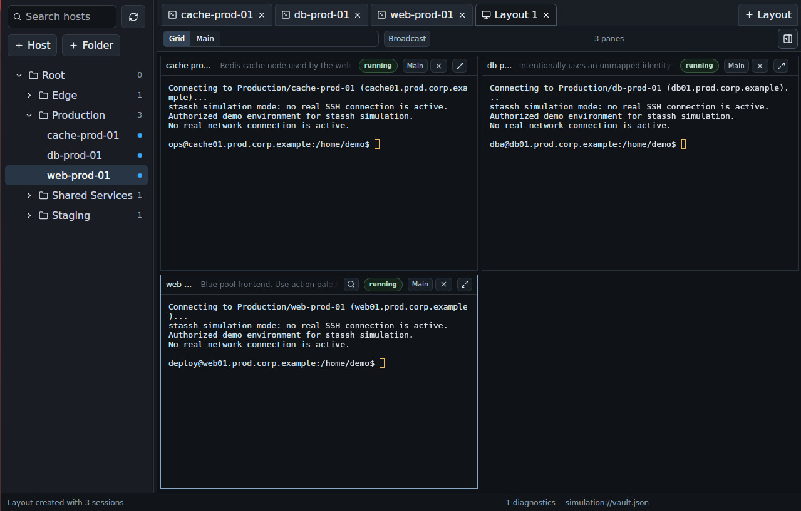
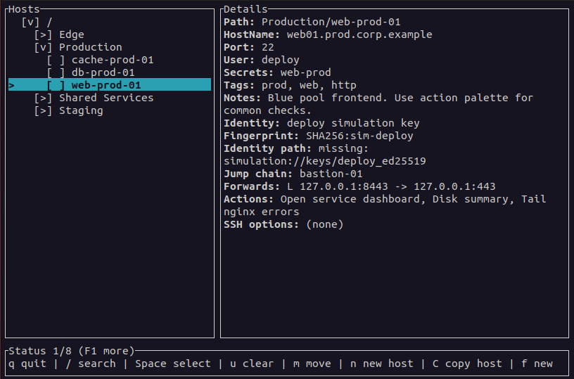

## The problem

You look after a few dozen machines: some servers, a lab, a couple of
customer sites behind a bastion. What you know about reaching them is spread
across `~/.ssh/config`, a notes file, your shell history and your memory.
Which key goes with which customer? Which box is only reachable through the
gateway? What was the forward you needed for that web admin page?

Hand-edited SSH config doesn't give you folders, search or notes, and it
gets awkward as soon as you move between a laptop, a workstation and a field
machine whose keys live in different places. The usual alternatives are
hosted SSH managers with an account, a sync service and their own SSH
implementation, which is more than you wanted to hand over.

<div class="compare">
  <div>
    <h3>The usual way</h3>
    <p>A long <code>~/.ssh/config</code>, notes elsewhere, and a hosted
    client if you want a nicer interface, with your inventory on someone
    else's server.</p>
  </div>
  <div class="good">
    <h3>With StaSSH</h3>
    <p>One local workspace with folders, tags, notes and search, a choice of
    terminal or desktop interface, and plain <code>ssh</code> doing the
    actual connecting.</p>
  </div>
</div>

StaSSH doesn't try to hide SSH. It organizes your hosts, then generates the
OpenSSH command (or a temporary OpenSSH config for jump chains and forwards)
and runs the `ssh` already on your system. Your agent, hardware keys,
known-hosts checks and password prompts all keep working exactly as before,
and you can always see the command it is about to run.

## How it works

Your workspace lives in `~/.ssh/stassh/`. The portable part, `vault.json`,
holds folders, hosts, jump chains, forwards, tags, notes and actions. Keys
are referred to by fingerprint, and a small machine-local file says where
each key lives *on this computer*. Copy or sync the folder with whatever
tool you already use, and the same workspace works on the next machine.

<ol class="steps">
  <li><strong>Import</strong><span>Create a vault and import your existing <code>~/.ssh/config</code>, including nested <code>Include</code> files.</span></li>
  <li><strong>Organize</strong><span>Sort hosts into folders, add notes and tags, set identities, jump hosts and forwards.</span></li>
  <li><strong>Connect</strong><span>Pick a host in the TUI or GUI, or script it from the CLI. OpenSSH does the rest.</span></li>
</ol>

<figure class="shot">
  
  <figcaption>The desktop app, in simulation mode: a host tree and three
  sessions in a grid layout.</figcaption>
</figure>

## Built for many hosts

<div class="features">
  <div>
    <h3>Three ways in, one workspace</h3>
    <p>The <code>stassh</code> CLI for scripts (with JSON output), a keyboard-driven
    terminal UI, and a desktop GUI. All three read and write the same vault.</p>
  </div>
  <div>
    <h3>Nothing between you and OpenSSH</h3>
    <p>Connections use the system <code>ssh</code>. The GUI shows a copy-and-paste
    command preview, and <code>stassh diagnose</code> shows what will be resolved.</p>
  </div>
  <div>
    <h3>Reusable actions</h3>
    <p>Define a workflow once, such as "forward a port, start <code>x11vnc</code>,
    open the viewer" or "send a file with <code>scp</code>", and run it on any host.
    Dry-run shows the exact plan first.</p>
  </div>
  <div>
    <h3>Many sessions at once</h3>
    <p>The GUI keeps sessions in tabs and arranges them in grid or main-pane
    layouts, with optional broadcast input. The TUI opens hosts in new tmux or
    byobu windows.</p>
  </div>
  <div>
    <h3>Your files, your sync</h3>
    <p>Plain JSON with a format version, private file permissions, and no
    account, telemetry or sync service. Concurrent edits from another
    frontend are detected instead of silently overwritten.</p>
  </div>
  <div>
    <h3>Safe to demo</h3>
    <p>Simulation mode in the TUI and GUI uses built-in demo hosts and
    scripted shells, so you can try it out or take screenshots without
    touching your real vault.</p>
  </div>
</div>

<figure class="shot">
  
  <figcaption>The terminal UI: folders on the left, everything about the
  selected host on the right.</figcaption>
</figure>

## What it supports today

StaSSH is at version 1.2, with working CLI, TUI and GUI frontends. Release
packages (`.deb` and `.rpm`) are built for **amd64 Linux** and install all
three programs. The CLI and TUI can also be built from source for other
Linux targets, including 32-bit x86 and ARM boards such as the Raspberry Pi.

- Folders, tags, notes and search across hosts
- Ordered jump chains; local, remote and dynamic (SOCKS) forwards
- Key identities by fingerprint, mapped to local key paths per machine
- Import from and export to OpenSSH config
- An optional encrypted `secrets.json` for fallback passwords or PINs tied
  to a host

Some things are deliberately out of scope: StaSSH is not a password manager,
team vault, sync service or monitoring tool, and it doesn't include its own
VNC, SFTP or RDP client; actions launch the tools you already have. The
OpenSSH importer covers a useful subset of the config language (no `Match`
blocks or token expansion yet), keys aren't discovered automatically from
`~/.ssh` or `ssh-agent`, and actions are written in JSON. Linux is the
first target; Windows support has been assessed in the docs but isn't built
yet.

## Get started

### 1. Install

On amd64 Debian or Ubuntu, download the `.deb` from the
[latest release](https://github.com/arturormk/stassh-rust/releases/latest)
(an `.rpm` is there too) and install it:

```bash
sudo apt install ./stassh_*_amd64.deb
```

This gives you `stassh`, `stassh-tui` and `stassh-gui`. To build the CLI
and TUI from source instead, you need Rust and Cargo:

```bash
git clone https://github.com/arturormk/stassh-rust.git
cd stassh-rust
cargo build -p stassh -p stassh-tui --release
sudo cp target/release/stassh target/release/stassh-tui \
    /usr/local/bin/
```

### 2. Try it with demo data

Simulation mode never reads or writes your real files:

```bash
stassh-tui --simulation
stassh-gui --simulation
```

### 3. Bring in your hosts

```bash
# Create ~/.ssh/stassh/vault.json
stassh vault init

# Import your existing OpenSSH config
stassh import openssh ~/.ssh/config

# Read-only health report: duplicates, unmapped keys
stassh vault check
```

Or add a host by hand, with a jump host if it needs one:

```bash
stassh host add bastion bastion.example.com --user admin
stassh host add db 10.0.0.5 --user root --jump bastion
```

### 4. Connect

```bash
# Browse, search and connect interactively
stassh-tui

# Or see what will run, then connect from the CLI
stassh diagnose db
stassh connect db
```

In the TUI, press `/` to search, `Enter` to connect, `a` for actions and
`t` to open a host in a new tmux window. In the GUI, double-click a host to
open it in an embedded terminal.

## Learn more

- **[Quick start for the terminal UI](https://github.com/arturormk/stassh-rust/blob/main/QUICKSTART-stassh-tui.md)**:
  from a fresh clone to a daily workflow, including portable builds.
- **[README](https://github.com/arturormk/stassh-rust/blob/main/README.md)**:
  every command, file location, key binding and importer detail.
- **[Actions how-to](https://github.com/arturormk/stassh-rust/blob/main/HOWTO-Actions.md)**
  and **[examples](https://github.com/arturormk/stassh-rust/tree/main/examples/actions)**:
  VNC over SSH, sending files and syncing directories.
- **[Secrets quick start](https://github.com/arturormk/stassh-rust/blob/main/QUICKSTART-secrets.md)**:
  the optional encrypted store for host-related secrets.
- **[Design blueprint](https://github.com/arturormk/stassh-rust/blob/main/docs/BLUEPRINT.md)**:
  the project's direction and data model.
- **[Releases](https://github.com/arturormk/stassh-rust/releases)** and
  **[issues](https://github.com/arturormk/stassh-rust/issues)**: packages,
  bug reports and feature requests.

StaSSH is dual-licensed under MIT or Apache-2.0, at your option. It runs
OpenSSH and any tools your actions launch as separate programs under their
own licences.
